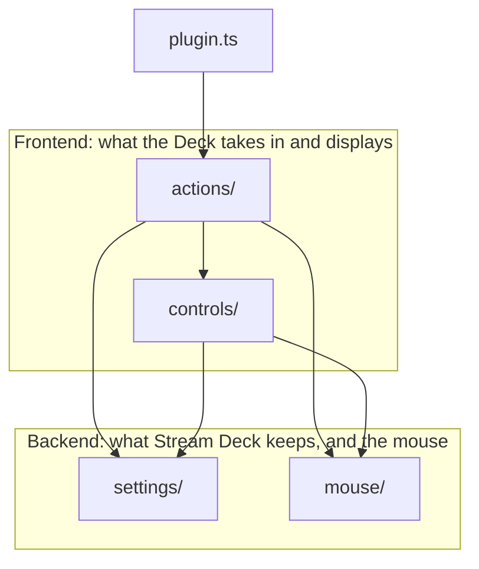

# Architecture

- [The layers](#the-layers)
- [The parts](#the-parts)
  - [The actions](#the-actions)
  - [The Battery key's image](#the-battery-keys-image)
  - [The settings schemas](#the-settings-schemas)
  - [The mouse](#the-mouse)
  - [The logger](#the-logger)
- [From a press to the mouse](#from-a-press-to-the-mouse)
  - [Set Host](#set-host)
  - [Battery](#battery)
- [The mouse is reached only through receivers](#the-mouse-is-reached-only-through-receivers)
- [Nothing is kept of the mouse between operations](#nothing-is-kept-of-the-mouse-between-operations)
- [One operation at a time](#one-operation-at-a-time)
- [Every request waits for its own reply](#every-request-waits-for-its-own-reply)
- [A switch goes one way](#a-switch-goes-one-way)
- [Operations return what came of them](#operations-return-what-came-of-them)
- [One reading for every Battery key](#one-reading-for-every-battery-key)
- [Settings are read against their schema](#settings-are-read-against-their-schema)
- [The key is drawn while the plugin runs](#the-key-is-drawn-while-the-plugin-runs)
- [A log of its own](#a-log-of-its-own)

This document describes how the plugin's parts fit together, and why they're built the way they are. The code's comments hold the rest: what each function does, and the details of the HID++ requests. How the plugin is used is in [the user guide][user-guide], and how its tests are written in [the testing guide][testing].

## The layers

`src/` is in layers, a folder each, and a module imports only from its own folder and the ones below it ([the contributing guide][contributing] states the rule):

- `src/plugin.ts` registers the actions with the SDK and connects to Stream Deck.
- `src/actions/` holds one module per action, which receives the events of its keys.
- `src/controls/` holds what the actions are built from: so far, what the Battery key draws.
- `src/settings/` holds what Stream Deck keeps of each key, and how it's read.
- `src/mouse/` holds the mouse, and how the plugin reaches it, through `node-hid`.
- `src/logging.ts` holds the logger every layer logs through.

The frontend calls the backend, never the other way round, so nothing in the backend knows how the Deck displays what it holds. The mouse's modules, for example, return a reading of the battery, and the Battery key turns it into an image. `controls/` takes the mouse's types, such as `Battery`, but never reaches the mouse itself. Each folder's `README.md` says what it holds.

## The parts

### The actions

Each action is a class that extends the SDK's `SingletonAction`, registered with `@action` under its id in `manifest.json`. The SDK creates one instance of each action for the whole plugin, and sends it the events of every key placed for it, each with the key it comes from and that key's settings. So what an instance holds is shared by all of its keys, and what belongs to one key is held by the key's id, or read from its settings on each event.

- `SetHostAction` holds nothing. On every event it reads the key's host from its settings, shows it in the title, and, on a press, sends the mouse there.
- `BatteryAction` holds what every key shows: the keys shown, by id, each with the style its settings choose, the last reading, whether the mouse answered the last read, the read under way, and the timer that reads again while a key is shown (see [One reading for every Battery key](#one-reading-for-every-battery-key)).

### The Battery key's image

`src/controls/battery-image.ts` turns what a key shows into its image. `styleOf` turns a key's settings into a `Style`: its background, its mouse, its battery, its bolt, the levels the percentage is colored by, and what it shows once the mouse isn't found. `batteryImage` draws a reading in a style, as an SVG data URL. It holds no state: the same reading and style always draw the same image, which is what lets the actions' tests check the image a key is set to, by drawing the one they expect.

### The settings schemas

`src/settings/schemas.ts` describes each setting an action reads as a `Setting`: its default, what a valid value is, and how to read one. A schema is an object of them, one per action, and `parseSettings` reads a key's settings against it, into a typed object, such as `BatterySettings` (see [Settings are read against their schema](#settings-are-read-against-their-schema)).

### The mouse

- `src/mouse/connection.ts` is the only module that imports `node-hid`. `reachMouse` runs an operation on one of the mouse's HID++ features: it finds the receivers plugged in, opens each one's HID++ channel, finds the mouse's slot and the feature's index, lends the operation the mouse it reached, as a `MouseConnection`, and closes the channel once the operation is done. The operation calls the feature's functions through `callFeature`, which waits for the reply, and `sendFeature`, for a request that gets none. `HidppError`, which stays inside the module, tells an error reply from a request that failed or got no reply.
- `src/mouse/host.ts` sends the mouse to a host (`switchHost`), as an operation on CHANGE_HOST.
- `src/mouse/battery.ts` reads the battery (`readBattery`), as an operation on UNIFIED_BATTERY.

A `MouseConnection` is a plain object, the channel, the slot and the feature's index, rather than a class with methods, since it's only good for the one operation it was lent to, and holds nothing that outlives it (see [Nothing is kept of the mouse between operations](#nothing-is-kept-of-the-mouse-between-operations)).

### The logger

`src/logging.ts` holds `logger`, which every module logs through, each in a scope of its own, such as `Host` or `Battery key`, and `RotatingFileTarget`, which writes it to a file (see [A log of its own](#a-log-of-its-own)).

## From a press to the mouse

### Set Host

1. Stream Deck sends the plugin the key's press, with its settings, and the SDK calls `SetHostAction.onKeyDown`.
2. The action reads the key's host from its settings, against its schema, and logs the press.
3. `switchHost` asks `reachMouse` for an operation on CHANGE_HOST, which waits for the operation before it to finish.
4. `reachMouse` lists the HID devices, and keeps the HID++ channel of each Bolt receiver. For the first receiver, it opens the channel, asks the receiver for the device paired in each slot, and, for a slot that holds an MX Master 3S, asks the mouse's IRoot for CHANGE_HOST's index. A mouse on another host doesn't answer, so the next receiver is tried.
5. With the mouse reached, the operation asks it for its hosts and the one it's on (`getHostInfo`). A host it doesn't have is refused, and a mouse already on the host is left alone. Otherwise, it sends `setCurrentHost`, which gets no reply, since the mouse leaves at once.
6. `reachMouse` closes the channel and returns what came of it, which `switchHost` logs.
7. The action shows a check mark when the mouse is on the host or on its way, and an alert otherwise.

### Battery

1. A key appears, and the SDK calls `BatteryAction.onWillAppear`. The action keeps the key, with the style its settings choose, starts the timer if it's the first key, shows the last reading on it, and reads the battery.
2. `readBattery` asks `reachMouse` for an operation on UNIFIED_BATTERY, which reaches the mouse as a switch does, in the same queue, and calls `getStatus`.
3. The action keeps the reading, or that the mouse didn't answer, and redraws every key shown from it, each in its own style.
4. A press, and the timer, read again from step 2. A change to a key's settings redraws that key, from the last reading.

## The mouse is reached only through receivers

Over Bluetooth, the mouse's HID collections, its pointer and its HID++ channel, share one device path, which macOS only lets an app with Input Monitoring open. A plugin runs inside the Stream Deck app, so the permission would be the app's, for every plugin it runs, and would let them read keystrokes system-wide. A Bolt receiver keeps its HID++ channel on a device path of its own, apart from its keyboard and mouse collections, which opens with no permission. So the plugin reaches the mouse only through receivers, one on each host, and asks for no permission ([#3]).

On Windows, a receiver's HID++ channel is two paths, one per report length, which differ only in their collection and in the last number of their instance. The plugin groups them into one channel, writes its requests to the short one, and reads the replies from both. On macOS, it's one path, which carries both.

## Nothing is kept of the mouse between operations

The mouse can leave for another host at any time, with its own button or from another computer, and a receiver can be unplugged. So every operation finds the receivers, the mouse's slot and the feature's index afresh, rather than keeping them from the last one, and closes the receivers before it returns. A feature's index differs from one device to another, so it's never hard-coded. Finding the mouse takes a few requests to the receiver, which answers in a few milliseconds, so finding it every time costs little next to the request that wakes the mouse.

## One operation at a time

Operations run one at a time, in the order they're asked for: a read of the battery waits for a switch under way, and the other way round. Two operations on one channel would mix their requests and replies. `reachMouse` chains each operation on the one before it, and a failed one doesn't stop the next.

## Every request waits for its own reply

A receiver sends more than replies on its HID++ channel, such as a notification when a device connects, and on Windows a reply comes on either of its paths. So a request waits for it on every path, for the report that answers it: from the same device index, for the same feature and function, with the plugin's software ID, which the reply echoes. It skips anything else, and fails on an error reply, or when nothing answers within 1.5 s. The first request to a mouse at rest takes up to about 1.2 s, since it wakes it, while a mouse the receiver doesn't reach, such as one on another host, gets the receiver's error at once.

## A switch goes one way

Once a computer sends the mouse to another host, it no longer reaches it, so it can't call it back. A key sends the mouse to a given host, and no key toggles between two. The mouse comes back with its own button, or from the other host's Deck. `setCurrentHost` gets no reply, since the mouse leaves before it could send one, so a switch counts as done once the request is written.

## Operations return what came of them

The mouse's modules never throw at the actions: an operation returns what came of it, such as `{ ok: true, outcome: "switched" }`, or why the mouse wasn't reached (`Unreached`): no receiver plugged in, none that reaches the mouse, or a request that failed. They log why, at the place that knows, so the actions only decide what the key shows, a check mark or an alert, and the log says the rest. A key's alert says something went wrong, and `mx3s.log` says what.

## One reading for every Battery key

There's one mouse, so every Battery key shows the same reading, and reading it once serves them all. A read asked for while one is under way, such as a press while a key appears, waits for that one rather than starting another. The battery is read when a key appears, when one is pressed, and every 10 minutes while one is shown: it drains slowly, and every read reaches the mouse, which wakes it. The timer starts with the first key shown and stops with the last, so nothing reads the battery while no key shows it.

The key's color comes from the percentage, on levels each key chooses, rather than from the level the mouse reports, since where the mouse puts each of its own levels isn't known, and can't be chosen. The level is only logged.

## Settings are read against their schema

Stream Deck keeps whatever a settings page saves, and sends it back with every event, so a setting can be missing, from a key placed before the page saved it, or invalid, edited by hand or left by an older version. Each action reads its settings against its schema on every event: a missing setting takes its default, and an invalid one takes it too, with a warning in the log, so no setting breaks a key. The defaults are the pages' own, which are what a new key saves, and the browser tests check both against the pages, so the plugin and the page show a new key the same way.

## The key is drawn while the plugin runs

The Battery key's image changes with every reading, so the plugin draws it while it runs, as an SVG, rather than choosing among images drawn beforehand. It draws it from the glyphs, the palette and the figures of `@daczarne/streamdeck-icons`, which the plugin's icons are drawn from too, so the package is a runtime dependency, bundled into the plugin. The percentage is set from the outlines of the figures, rather than as SVG text, which Stream Deck would draw with whatever fonts the computer has. The image is drawn at 144 px, a key's size at high density, which Stream Deck scales down for the others.

## A log of its own

The plugin logs through a logger of its own, rather than the SDK's, whose file target starts a new file every time the plugin starts, so a few restarts while chasing a problem would push out the run that showed it. `RotatingFileTarget` writes to `logs/mx3s.log` in the plugin folder, carries on across restarts, and rotates the file once it reaches 1 MB, keeping four older files. A write that fails is dropped, so logging never fails a switch. The SDK's own files hold only what the SDK reports itself, such as an uncaught exception.

[#3]: https://github.com/daczarne/streamdeck-mx3s/issues/3
[contributing]: ../contributing.md
[testing]: testing.md
[user-guide]: ../user_guide/README.md
